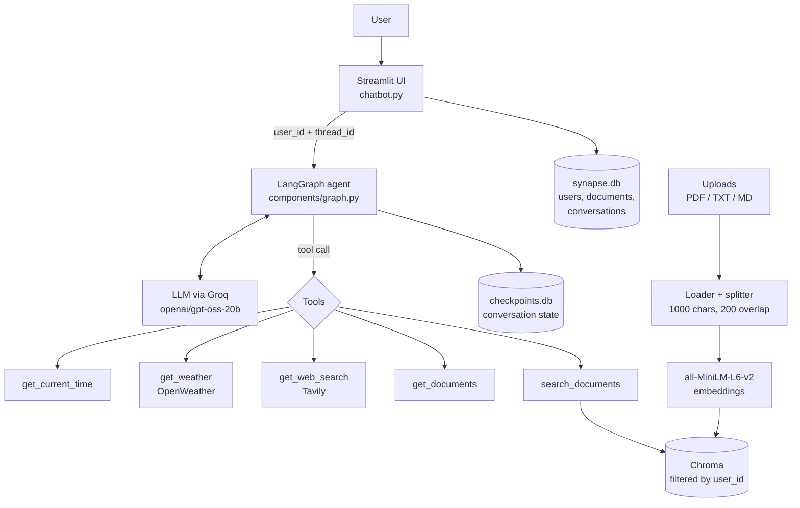

<div align="center">

# SynapseAI

**A multi-user AI assistant that chats, searches your own documents with cited sources, and calls tools, built on LangGraph.**

[](https://www.python.org/)
[](https://streamlit.io/)
[](https://langchain-ai.github.io/langgraph/)
[](https://synapse-ai-vbp.streamlit.app/)
[](LICENSE)

[**Live demo**](https://synapse-ai-vbp.streamlit.app/) · [Demo video](#demo) · [Getting started](#getting-started) · [Known limitations](#known-limitations)

</div>

<!-- Add docs/screenshots/hero.png, then uncomment the next line:
<p align="center"></p>
-->

## Demo

https://github.com/user-attachments/assets/c8fa5558-82db-43e9-b147-e6ff7c8776f6

<!-- Add a Screenshots section once you have images in docs/screenshots/:
## Screenshots

| Sign in | Document Q&A with sources |
| :---: | :---: |
|  |  |

| Tool use | Mobile |
| :---: | :---: |
|  |  |
-->

## Features

- **Streaming chat** with an LLM served through Groq's OpenAI-compatible API (`openai/gpt-oss-20b`).
- **Agent with tool calling**, orchestrated as a LangGraph graph: the model decides when to call a tool, then continues with the result.
- **Document Q&A (RAG)** over your own PDF, TXT and Markdown files, with source filenames and page numbers shown under each answer.
- **Incremental indexing**: files are tracked by SHA-256 hash and classified as new, changed, unchanged or deleted, so unchanged files are not re-embedded.
- **Per-user isolation**: accounts with Argon2 password hashing (via `pwdlib`), per-user upload folders, and vector search filtered by user ID.
- **Persistent conversations**: multiple chats per user, resumable after logout, with short LLM-generated titles.
- **Five agent tools**: current time, weather, list uploaded documents, search document contents, web search.
- **Custom dark UI** with a responsive layout for small screens.
- **Optional LangSmith tracing** through environment variables.

## How it works



The graph has two nodes, `agent` and `tools`. After every model call, a conditional edge routes to `tools` if the model requested a tool, otherwise the turn ends. Document search is an ordinary tool, not a separate pipeline, so the model decides when to use it. The signed-in user's ID is passed through LangGraph runtime context, which is how the document tools only see that user's files.

**Indexing.** Each user's uploads live in `data/users/<user_id>/uploads/`. Their index state (file hashes) is stored in `data/users/<user_id>/index_state.json`. Chunks are stored in one shared Chroma collection with `user_id` and `document_id` metadata. Retrieval uses similarity search with `k=4`.

**Example (illustrative).**

| | |
| --- | --- |
| **Input** | "What does my uploaded handbook say about the refund policy?" |
| **Agent** | calls `search_documents(query="refund policy")` |
| **Output** | An answer grounded in the retrieved chunks, followed by a Sources list such as `handbook.pdf — page 4` |

## Tech stack

| Area | Technology |
| --- | --- |
| Language | Python 3.12+ |
| UI | Streamlit with custom CSS |
| Agent | LangChain, LangGraph (`StateGraph`, `ToolNode`, SQLite checkpointer) |
| LLM | Groq, via `langchain-openai` (`ChatOpenAI` with a custom base URL) |
| RAG | Chroma, Hugging Face `sentence-transformers/all-MiniLM-L6-v2`, PyPDF, `RecursiveCharacterTextSplitter` |
| Tools | Tavily (web search), OpenWeather, a time zone API |
| Storage | SQLite (app data and LangGraph checkpoints), local files, Chroma on disk |
| Auth | `pwdlib` with Argon2 |
| Observability | LangSmith (optional) |
| Tooling | uv |

## Project structure

```text
synapse-ai/
├── chatbot.py                 # Streamlit app: auth, sidebar, chat, document management
├── components/
│   ├── auth.py                # Password hashing and verification
│   ├── context.py             # UserContext passed into LangGraph
│   ├── conversation.py        # Conversation metadata (SQLite)
│   ├── database.py            # SQLite connection and schema
│   ├── document.py            # Document records (SQLite)
│   ├── graph.py               # LangGraph agent, streaming, checkpointing
│   ├── llm.py                 # Model configuration
│   ├── rag.py                 # Loading, chunking, incremental indexing, retrieval
│   ├── ui.py                  # Theme and reusable UI pieces
│   ├── user.py                # User creation and authentication
│   └── tools/
│       ├── documents.py       # List uploaded documents
│       ├── search_documents.py# Search document contents (returns sources)
│       ├── time.py            # Current time for a location
│       ├── weather.py         # Current weather
│       └── web_search.py      # Web search
├── .env.example
├── pyproject.toml
└── uv.lock
```

The `data/` folder (SQLite databases, Chroma index, user uploads) is created at runtime and is git-ignored.

## Getting started

**Requirements:** Python 3.12+, Git, [uv](https://docs.astral.sh/uv/), and a [Groq API key](https://console.groq.com/keys).

```bash
git clone https://github.com/visheshbpatel/synapse-ai.git
cd synapse-ai
uv sync
cp .env.example .env      # then edit .env and add your keys
uv run streamlit run chatbot.py
```

Open http://localhost:8501, create an account, and log in. The first time you index a document, the embedding model (`all-MiniLM-L6-v2`) is downloaded from Hugging Face, so that step needs internet access.

### Environment variables

| Variable | Required | Purpose |
| --- | --- | --- |
| `GROQ_API_KEY` | Yes | Key for the chat model |
| `GROQ_BASE_URL` | Yes | `https://api.groq.com/openai/v1` |
| `OPENWEATHER_API_KEY` | No | Enables the weather tool |
| `TAVILY_API_KEY` | No | Enables web search |
| `TIMEZONE_API_TOKEN` | No | Time lookup for cities not in the built-in list (Mumbai, Delhi, India, Tokyo, London, New York, Los Angeles) |
| `LANGSMITH_API_KEY` | No | LangSmith tracing |
| `LANGSMITH_TRACING` | No | `true` to enable tracing |
| `LANGSMITH_PROJECT` | No | LangSmith project name |

Without the optional keys, the matching tools return a friendly "unavailable" message and the rest of the app keeps working.

## Usage

There is no public HTTP API; everything goes through the Streamlit UI.

1. **Sign up** with a username, email and password, then **log in** with your email.
2. Open **Documents** in the sidebar, choose PDF, TXT or MD files, and click **Index Documents**.
3. Ask questions in the chat. Example prompts:
   - "Summarise what my notes say about deployment." (document search, with sources)
   - "What documents do I have uploaded?" (`get_documents`)
   - "What's the weather in Indore?" (`get_weather`)
   - "What time is it in Tokyo?" (`get_current_time`)
   - "What's the latest news about LangGraph?" (`get_web_search`)
4. Use **New Chat** to start a thread, or pick an earlier conversation from the sidebar.
5. Remove a document with the **×** next to its name; its file, index entries and record are deleted.

## Tests

There is no automated test suite yet (see [Roadmap](#roadmap)).

## Deployment

The live demo runs on Streamlit Community Cloud. To deploy your own copy:

1. Fork the repo and create a new app on [Streamlit Community Cloud](https://streamlit.io/cloud) pointing at `chatbot.py`.
2. Add the variables from the table above under **Secrets** (never commit them).
3. Be aware that SQLite files, uploads and the Chroma index are written to the local disk, which on hosted platforms may not survive restarts. Use a persistent volume or move storage to a managed database before relying on it for real data.

## Known limitations

- **No automated tests yet.**
- **Re-indexing a changed file is buggy.** In `components/rag.py`, new chunks are added and then every chunk with that `document_id` is deleted, which also removes the new ones. After editing and re-indexing a file, delete it and upload it again.
- **Local storage only.** SQLite, Chroma and uploads live on the app's disk, so this is single-instance and not suited to horizontal scaling.
- **Basic authentication.** Passwords are hashed with Argon2, but there is no email verification, password reset, rate limiting or password policy. Sessions live in Streamlit session state.
- **No conversation rename or delete**, and no per-message editing.
- **Indexing is manual and synchronous** (click "Index Documents"); large PDFs block the UI while they are processed.
- **Document types:** PDF, TXT and Markdown only. Scanned PDFs without a text layer produce no text.
- **Dark theme only**; there is no light mode or toggle.
- **Time tool** returns the time of day only (no date or zone name), and its built-in city list is small.

## Roadmap

*Planned, not implemented:*

- [ ] Rebuild the backend as a FastAPI service with the UI as a separate client
- [ ] Fix incremental re-indexing for changed files
- [ ] Add a pytest suite (database layer, indexing logic, tools) and run it in CI
- [ ] Containerise with Docker
- [ ] Conversation rename and delete
- [ ] Hosted persistent storage

## License

Released under the [MIT License](LICENSE).
